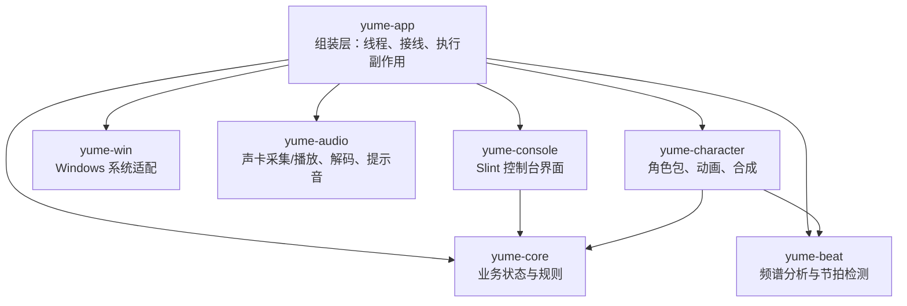

# 架构

本文是 Rust 版的架构约定。**改代码前先读本文和仓库根目录的 `AGENTS.md`。** 本文中的规则大多由 `cargo xtask check` 自动检查，违反即失败。

功能范围见 [功能清单](功能清单.md)，角色包格式见 [角色包格式](角色包格式.md)。

---

## 1. 设计目标

1. **业务规则集中在一处，并且可测。** 计时、表情、随机事件、待办、设置的规则，全部写在一个纯逻辑 crate 里，不依赖窗口、音频、时钟和随机数。
2. **系统相关代码是薄薄一层，而且不认识业务。** 窗口、托盘、声卡这些代码只管"怎么做"，不管"为什么做"。
3. **高频数据不走业务状态。** 音频采样和节拍帧每秒几十到几万次，走专用通道；业务状态每秒最多几次变化。
4. **加功能时，位置是唯一的。** 第 9 节的表格回答"这个改动该写在哪"。找不到对应行，说明需要先改本文。

## 2. 分层



| 层 | crate | 职责 | 允许依赖的内部 crate | 关键限制 |
|---|---|---|---|---|
| L0 纯逻辑 | `yume-core` | 应用状态 `AppState`、命令 `Command`、副作用 `Effect`、全部业务规则、持久化数据结构 | 无 | 无 I/O、无 `unsafe`、不读系统时钟、不用全局随机数、不开线程 |
| L0 纯逻辑 | `yume-beat` | 频谱分析器（与 Web Audio `AnalyserNode` 等价）、节拍检测器、锁拍点头曲线、`MotionFrame` | 无 | 同上 |
| L0 纯逻辑 | `yume-character` | 角色包格式与校验、动画（弹簧、眨眼、粒子）、CPU 合成出一帧 BGRA 画面 | `yume-core`、`yume-beat` | 同上；读文件只经由传入的 `PackSource` |
| L1 系统适配 | `yume-win` | 分层窗口与逐像素点击穿透、托盘、全局热键、单实例、开机自启、全屏检测、配置文件读写 | 无 | **不认识任何业务类型**；`unsafe` 只允许出现在这里 |
| L1 系统适配 | `yume-audio` | WASAPI 回环采集、音频文件解码与循环播放、提示音合成与播放、设备枚举 | 无 | 不认识业务类型；只输出采样，不做节拍分析 |
| L2 界面 | `yume-console` | Slint 界面；把 `AppState` 投影成界面数据；把用户操作翻译成 `Command` | `yume-core` | 不直接调系统 API；不保存业务状态 |
| L3 组装 | `yume-app` | `main`；创建线程；把适配层事件翻译成 `Command`；执行 `Effect` | 全部 | **不写业务规则**，只写接线 |

依赖方向只能朝下。L1 的两个适配 crate 互不依赖，也不依赖 L0，可以单独拿去别的项目复用。

## 3. 控制面：Command → update → Effect

业务状态只有一份，即 `yume_core::AppState`，由主线程独占。**唯一的修改入口**是：

```rust
pub fn update(state: &mut AppState, cmd: Command, ctx: &mut Ctx) -> Effects
```

- `Command`：发生了什么。来源包括用户操作（控制台、托盘、热键、右键菜单、拖入文件）、系统事件（音频已启动、音频出错、角色包加载完成）和时钟（`Tick`）。
- `Ctx`：外部注入的当前墙钟时间和随机数源。测试里可以注入固定值。
- `Effect`：需要外部完成的**一次性动作**，比如播放提示音、启动或停止音频、加载角色包、退出。`update` 只返回描述，不执行。
- **持续性的属性不用 Effect，而是派生**：桌宠锁定、可见性、缩放、控制台显隐、开机自启、桌宠场景（`derive::pet_scene`、`derive::pet_window`），以及需要保存的数据（`AppState::persisted()`）。组装层在每次 `update` 之后比较前后的派生值，有变化才应用。这样不论状态从哪条路径改变，都不会漏掉"同步到窗口"或"保存到文件"。

示例：倒计时归零

```
Tick(now) → update 发现剩余时间 ≤ 0 →
  状态改为 Completed，并返回 [Effect::PlayChime]（提示音开关开启时）
→ yume-app 收到 Effect::PlayChime → 调用 yume-audio 播放三音
```

`yume-core` 内部结构：

| 目录 | 内容 |
|---|---|
| `model/` | 各领域的子状态与规则（计时、事件矩阵、表情、待办、设置、音频、桌宠）。每个子状态只管自己，方法可以单独测试 |
| `command.rs` | `Command`，按领域分组 |
| `update/` | 每个领域一个处理模块，负责跨领域协调（如"开始计时会切到自习"）；`update/tests.rs` 是按功能清单写的场景测试 |
| `effect.rs` | 一次性动作 |
| `derive.rs` | 派生输出 |
| `persist.rs` | 持久化结构与宽松读取 |

规则：

1. 界面和系统事件**不能直接改状态**，只能发 `Command`。`AppState` 的字段对 crate 外只读，编译器保证这一点。
2. `update` 必须是确定性的：相同的状态、命令和 `Ctx`，得到相同的结果。
3. 需要等待的事情（定时、随机表情到期）用状态里的截止时间加 `Tick` 实现，不在 core 里开定时器。
4. 面向用户的错误在 core 里是**枚举**（如 `AudioError::DeviceUnavailable`），中文文案由 `yume-console` 翻译。

## 4. 数据面：音频 → 节拍 → 画面

```
声卡回环 / 文件解码（yume-audio，音频线程）
   │ f32 单声道采样（无锁环形缓冲）
   ▼
节拍线程（yume-app 里调用 yume-beat）：固定 60 Hz
   Analyser 取最近 2048 点 → BeatDetector → MotionFrame
   │ 最新一帧写入 MotionSlot（覆盖式，读方只取最新）
   │ 每 120 ms 发一次 Command::AudioTelemetry 给主线程（控制台显示用）
   ▼
桌宠线程（yume-app 里调用 yume-character + yume-win）：30–60 fps
   读 MotionSlot + 最新的 PetScene → 角色动画 → 合成 BGRA → UpdateLayeredWindow
   画面没有可见变化时跳过合成和提交
```

- `PetScene` 是 core 从 `AppState` 推出来的"桌宠该显示什么"：活动模式、是否放音乐、计时是否在跑、当前表情、是否打瞌睡等。主线程在它变化后经控制通道发给桌宠线程。
- 节拍检测以固定 60 Hz 驱动，结果与屏幕刷新率无关。
- 节拍帧不经过 `update`。core 只拿到低频的遥测数据（BPM、音量、是否锁拍、已跟拍数），用于显示和规则判断。

## 5. 线程模型

| 线程 | 拥有 | 做什么 | 怎么与别人通信 |
|---|---|---|---|
| 主线程 | `AppState`、Slint 事件循环、控制台、托盘、热键、定时器 | 执行 `update` 和 `Effect`，把派生值的变化应用出去，写存档 | 其他线程用 `slint::invoke_from_event_loop` 投递 `Command`；主线程用控制通道指挥其他线程 |
| 桌宠线程 | 桌宠窗口及其消息循环、角色渲染器 | 动画、合成、提交画面；处理拖动、单击、右键、拖入文件 | 收 `PetControl`（场景、窗口属性、新角色、退出）；读 `MotionSlot`；发 `Command` |
| 节拍线程 | `Analyser`、`BeatDetector` | 60 Hz 分析 | 收 `BeatControl`（启停、倍速纠正、退出）；读采样缓冲；写 `MotionSlot`；发遥测 `Command` |
| 音频服务线程 | 全部 cpal 流 | 按命令开关回环采集、文件播放、提示音 | 收 `AudioService` 的方法调用（内部是通道）；回报 `AudioEvent`，由组装层翻译成 `Command` |
| 音频回调 / 解码线程 | 采集或播放回调、文件解码 | 搬运采样 | 写采样缓冲（无锁）；回调里不分配内存、不加锁 |
| 角色加载线程（临时） | 正在加载的角色包 | 读图、建渲染器 | 完成后投递回主线程；由主线程确认仍是当前角色后再交给桌宠线程 |

线程间只允许以下四种通信方式。需要新的方式时，先改本节。

1. `slint::invoke_from_event_loop`：任何线程 → 主线程。
2. `std::sync::mpsc` 控制通道：主线程 → 桌宠 / 节拍 / 音频服务线程。
3. 最新值槽（`MotionSlot`，加锁、只存最新一帧）：节拍线程 → 桌宠线程。
4. 无锁采样缓冲（`SampleRing`、`PcmQueue`）：音频 ↔ 节拍、解码 → 播放回调。

## 6. 时间与随机数

- **墙钟**（Unix 毫秒，`yume_core::WallMs`）：学习计时用。电脑休眠后醒来，倒计时应该已经走过休眠的时长。
- **单调时钟**（毫秒 `f64`，从程序启动算起）：动画和节拍用。`nextBeatAt` 等预测值都在这个时间轴上。
- 两个时钟都由 `yume-app` 读取后传入，L0 crate 里禁止调用 `Instant::now`、`SystemTime::now`（clippy 检查）。
- 随机数通过 `yume_core::Random` trait 注入，测试用固定种子。

## 7. 关键接口

```rust
// yume-core
pub struct AppState { /* settings, activity, timer, dialog, switches, expressions, todo, audio, pet, character */ }
pub enum Command { /* 按领域分组：用户操作、系统事件、Tick */ }
pub enum Effect  { PlayChime, StartAudio { .. }, StopAudio, ShiftTempo(..), ListAudioDevices,
                   ScanCharacters, LoadCharacter { .. }, OpenSoundSettings, FocusConsole, Quit }
pub fn update(state: &mut AppState, command: Command, ctx: &mut Ctx<'_>) -> Vec<Effect>;
pub fn derive::pet_scene(state: &AppState) -> PetScene;
pub fn derive::pet_window(state: &AppState) -> PetWindow;

// yume-beat
pub struct Analyser;       // fft 2048、Blackman 窗、平滑 0.08、-90..-3 dB，与 Web Audio AnalyserNode 一致
pub struct BeatDetector;   // 与 tools/beat-baseline 的 JS 基准引擎逐帧一致
pub struct MotionFrame { beat, onset, strength, level, bass, bpm, beats, locked, next_beat_at, period_ms }
pub fn locked_beat_nod(now, next_beat_at, period_ms, strength) -> Option<f64>;

// yume-character
pub trait CharacterRenderer: Send {
    fn base_size(&self) -> (f32, f32);                     // 角色包定义的视口大小（逻辑像素）
    fn advance(&mut self, now_ms: f64, scene: &PetScene, motion: &MotionFrame);
    fn render(&mut self, frame: &mut Frame, scale: f32) -> bool; // 写入预乘 alpha 的 BGRA；false 表示画面没变
}
```

`CharacterRenderer` 是换角色的扩展点。现在只有分层 PNG 一种实现（`LayeredCharacter`）。以后要支持 Live2D，就新建一个 crate 实现这个 trait，桌宠窗口和点击穿透都不用改，因为它们只认 BGRA 画面。

## 8. 持久化与文件位置

| 内容 | 位置 |
|---|---|
| 设置、学习时长、表情条件规则、待办、桌宠位置与缩放、当前角色 | `%APPDATA%\韵梦桌伴\state.json`（单文件、带版本号、先写临时文件再改名，保证原子性） |
| 控制台自定义背景图片（可选） | `%APPDATA%\韵梦桌伴\background.<ext>` |
| 自定义表情素材与清单 | `%APPDATA%\韵梦桌伴\custom_expressions\<id>\` |
| 用户安装的角色包 | `%APPDATA%\韵梦桌伴\characters\<id>\` |
| 内置角色包 | 程序同级 `characters\<id>\` |
| 日志 | `%LOCALAPPDATA%\韵梦桌伴\logs\` |
| 外接 Markdown 待办清单（可选） | 用户选定的 `.md` 文件路径（原地读写，保留非任务段落） |

- 持久化的结构体定义在 `yume-core::persist`，序列化格式由 serde 决定；文件读写在 `yume-win`。
- 读取失败或字段非法时，用默认值逐字段兜底，不弹错。

## 9. 改什么，去哪里

| 要做的事 | 改哪里 | 不要改哪里 |
|---|---|---|
| 新增或修改一条业务规则（计时、表情、事件、待办） | `yume-core` 对应模块 + 单元测试 | 界面、`yume-app` |
| 新增一个设置项 | `yume-core::settings`（字段、默认值、取值范围）→ `Command` → 控制台界面 | 不要在 Slint 里存 |
| 控制台新增页面或控件 | `yume-console`（`.slint` + `view.rs` 投影）；需要新操作时在 core 加 `Command` | 不要在 Slint 回调里写逻辑 |
| 桌宠新增一种动作或特效 | `yume-character`（动画参数写进角色包，不写死在代码里） | `yume-win` |
| 角色包新增字段 | `yume-character::pack` + 校验 + `docs/角色包格式.md` | — |
| 支持新的角色技术（如 Live2D） | 新 crate 实现 `CharacterRenderer`，在 `yume-app` 里注册 | 桌宠窗口代码 |
| 窗口、托盘、热键、透明度、系统文件选择框等系统行为 | `yume-win`，接口只用基础类型 | 不要引用 core 类型 |
| 主题配色方案、自定义快捷键规则、Markdown 待办解析与无损回写 | `yume-core::model` + 单元测试 | 界面、`yume-app` |
| 背景模式/透明度/圆角/强调色派生、表情条件规则、表情编辑器草稿与校验 | `yume-core::model`（`theme.rs`、`settings.rs`、`expr_rules.rs`、`editor.rs`）+ 测试 | 界面、`yume-app` |
| 自定义表情合并进角色包 | `yume-character::pack`（`load` 的 custom 参数）；文件读写/复制/删除在 `yume-app/src/custom_expr.rs`；背景图片解码在 `yume-console`（`Console::set_background_image`） | `yume-core`、`yume-win` |
| 系统字体枚举、字体搜索筛选、按文种掩码注册（`font_mask`）与外部 `.ttf`/`.otf` 注册 | `yume-console::fonts`、`yume-console::font_mask`（经由 Slint fontique 集合） | `yume-core`、`yume-win` |
| 新的音源 | `yume-audio` 输出采样；`yume-core` 加音源枚举 | `yume-beat` |
| 节拍算法 | `yume-beat`，必须跑通回归测试 | — |
| 新增一次性动作 | core 加 `Effect` 变体 → `yume-app` 的副作用执行模块 | — |
| 新增需要同步到窗口的属性 | `yume-core::derive` 加字段 → `yume-app` 比较差异后应用 | 不要用 `Effect` |
| 新增需要保存的数据 | `yume-core::persist`（结构 + 宽松读取 + 测试），`AppState::persisted()` 带上它 | 不要在别处直接写文件 |
| 托盘菜单、全局快捷键、定时器 | `yume-app/src/shell.rs`（只把事件翻译成 `Command`） | 不要在这里改状态 |
| 桌宠右键菜单、拖动、单击 | `yume-app/src/pet.rs`（翻译成 `Command`）；窗口行为在 `yume-win` | — |

## 10. 错误处理与日志

- L0、L1 用 `thiserror` 定义具体错误类型；`anyhow` 只允许在 `yume-app` 中使用。
- 所有 crate 只用 `log` 宏打日志，日志后端只在 `yume-app` 初始化。
- 非测试代码里禁止 `unwrap()`、`expect()`、`panic!`（clippy 检查）。确实不可能失败时，用 `#[allow(clippy::expect_used, reason = "为什么不可能失败")]` 写明原因；不写原因的 `allow` 同样会被拒绝。
- 适配层出错时返回错误，由 `yume-app` 翻译成 `Command`（如 `AudioCommand::Failed`），再由 core 决定状态如何变化。

## 11. 测试

| 层 | 测什么 | 在哪跑 |
|---|---|---|
| `yume-core` | 每条规则一个单元测试；按功能清单写场景测试（计时公式、暂停续计、活动切换确认、随机表情池、打瞌睡规则、事件矩阵、待办、设置范围） | Linux / Windows |
| `yume-beat` | 与 JS 基准引擎逐帧对比：`tools/beat-baseline` 在 Node 里运行基准引擎生成轨迹，Rust 结果必须在容差内一致 | Linux / Windows |
| `yume-character` | 角色包校验；固定场景渲染成 PNG，与仓库中的基准图对比（`UPDATE_SNAPSHOTS=1` 时更新基准图） | Linux / Windows |
| `yume-console` | `view.rs` 投影函数的单元测试；`tests/screens.rs` 用软件渲染把各页面画成 PNG（`target/ui-screens/`），人工检查 | Linux / Windows |
| `yume-win` / `yume-audio` | 纯逻辑部分（采样队列、重采样、提示音合成）有单元测试；窗口和声卡需要在 Windows 桌面上实际运行检查 | Windows |

## 12. 守护机制

分层靠规则自觉是守不住的，所以由工具强制执行。`cargo xtask check` 会依次做：

1. `cargo fmt --check`
2. `cargo clippy --workspace -- -D warnings`。L0 crate 有各自的 `clippy.toml`，禁止调用系统时钟、全局随机数和线程。
3. `cargo test`
4. **依赖方向检查**：读取 `cargo metadata`，内部依赖必须符合第 2 节的表格。允许的依赖表只写在 `xtask/src/arch.rs` 里，修改它必须同时修改本文。
5. **文件长度检查**：单个 `.rs` 文件不超过 500 行，`.slint` 文件不超过 400 行，防止单个文件越写越大。
6. L0 crate 必须带 `#![forbid(unsafe_code)]`。

CI（`.github/workflows/ci.yml`）在 Linux 和 Windows 上各跑一遍 `cargo xtask check`：Linux 上测试与平台无关的 crate，并对 Windows 目标做 clippy 类型检查；Windows 上跑完整的 clippy 和全部测试。发布流程见 `AGENTS.md`。
